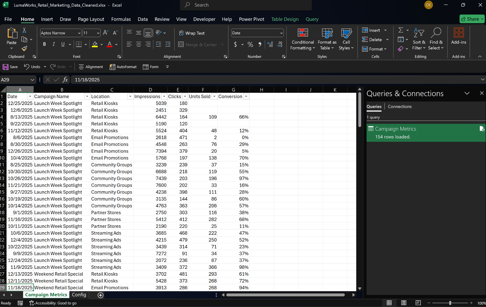
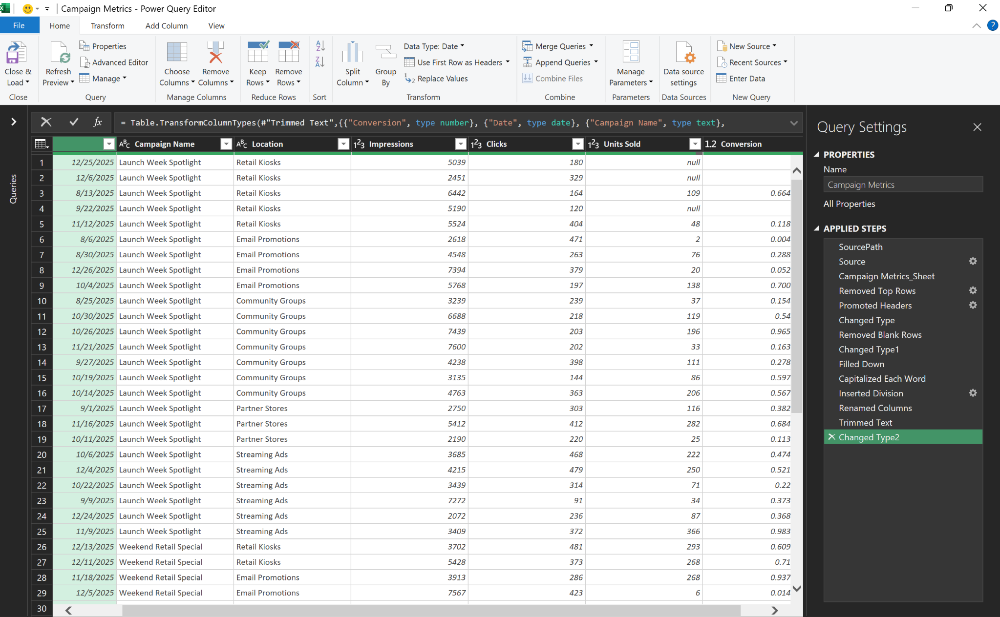
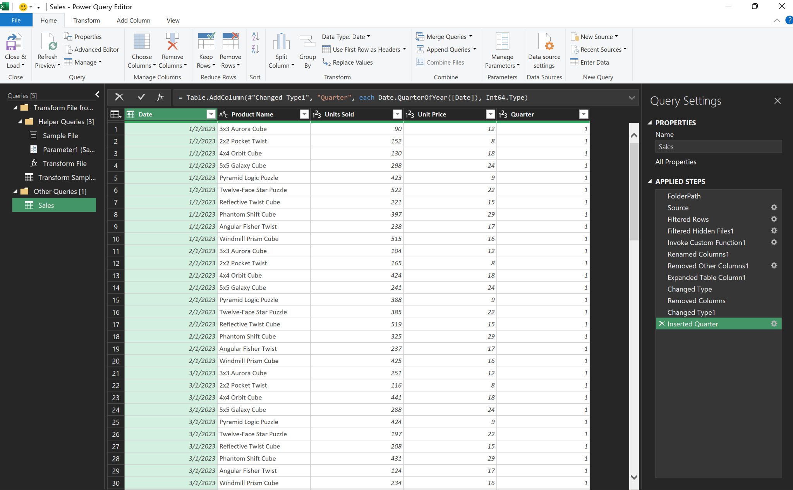
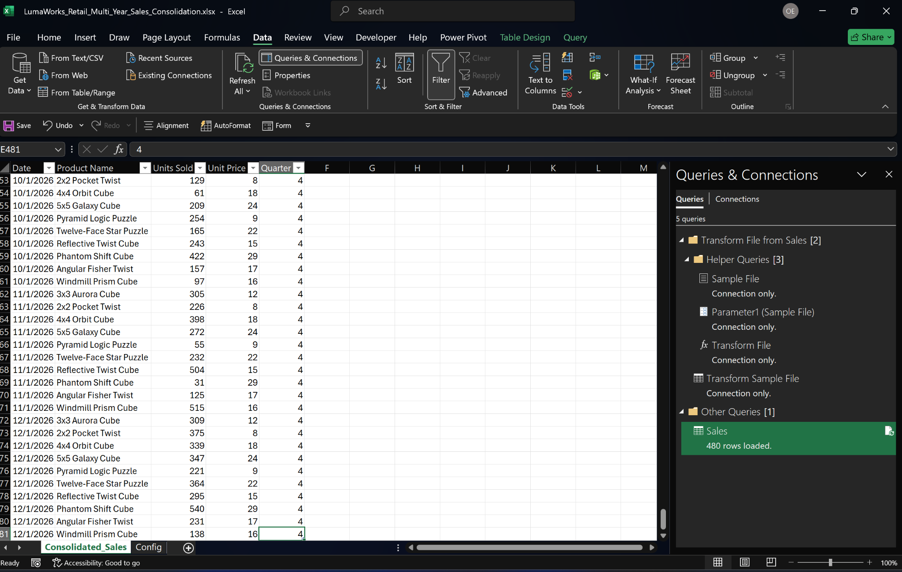
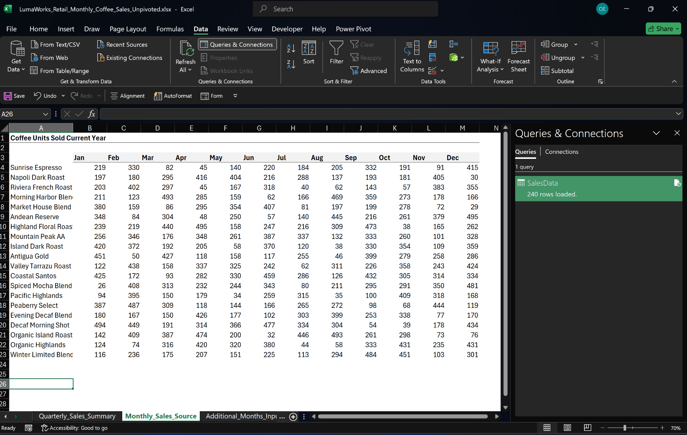
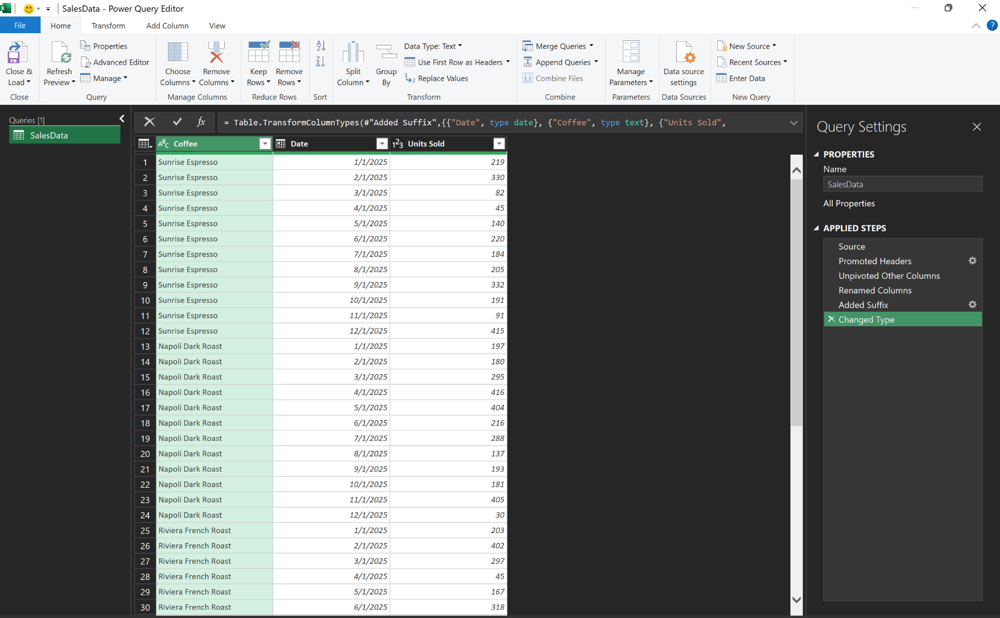
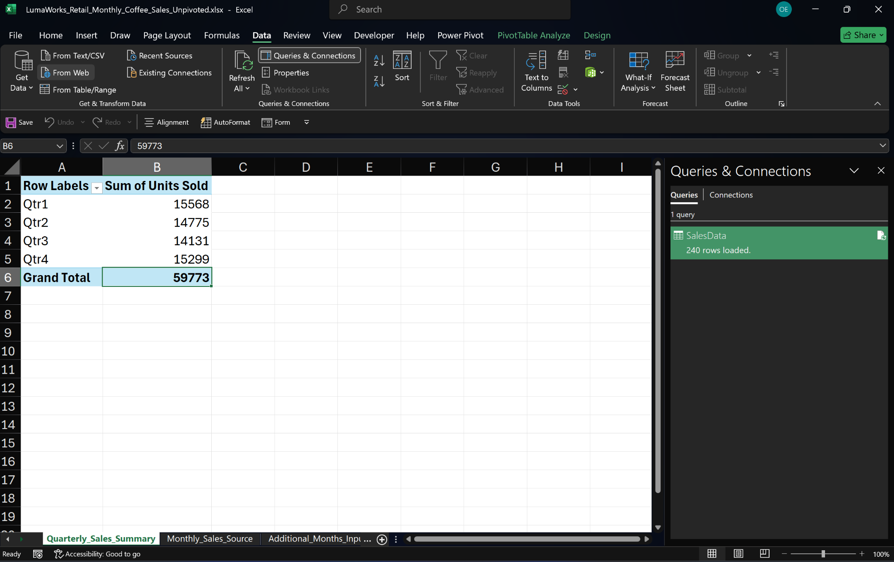

# Excel Power Query | Data Cleaning, Consolidation & Transformation

**Three practical Excel Power Query case studies · LumaWorks Retail (fictional business scenario)**

This portfolio demonstrates how a data operations workflow can turn messy spreadsheets, separately delivered sales files, and wide monthly reports into **clean, structured, refreshable Excel outputs**.

The datasets are **synthetic, customized training exercises**, not records from a real employer or client. The analysis, transformation workflows, validation, and portable-file setup are presented as practical portfolio work.

## Project overview

| Case study | Business problem | Power Query workflow | Verified output |
|:---|:---|:---|:---|
| **01 · Marketing Data Cleaning** | Inconsistent campaign labels, blank group fields, and incomplete sales figures | Header cleanup, Fill Down, text standardization, missing-value handling, ratio calculation, explicit data types | **154 records** |
| **02 · Multi-Year Sales Consolidation** | Annual sales spread across separate CSV files | Folder-based ingestion, standardized transformations, date typing, quarter calculation, refresh | **480 records** · 2023–2026 |
| **03 · Monthly Coffee Sales Transformation** | Product-by-month sales matrix unsuitable for row-based reporting | Named-range ingestion, unpivoting, month-to-date conversion, quarterly PivotTable | **240 records** · **59,773 units** |

---

## 01 · Marketing Data Cleaning

**Business challenge.** Marketing records arrived with grouped campaign/channel labels, extra heading and spacer rows, text inconsistencies, and missing `Units Sold` values. The business needed a dependable, report-ready table without misrepresenting unknown sales figures.

**Transformation.** Imported the Excel source, removed redundant rows, promoted headers, filled down campaign and location labels, standardized and trimmed text, created `Conversion = Units Sold / Clicks`, and assigned appropriate Date, Text, Whole Number, and Decimal Number data types.

**Quality outcome.** **154 records preserved**. Campaign and location fields are populated; three genuinely missing `Units Sold` values remain null, as do their calculated ratios. Here, *Conversion* means **units sold per click**, not a verified customer-level purchase-conversion rate.

**Excel deliverable:** [`LumaWorks_Retail_Marketing_Data_Cleaned.xlsx`](LumaWorks_Retail_Marketing_Data_Cleaned.xlsx)

| Refreshed Excel output | Power Query cleaning and validation steps |
|:---:|:---:|
|  |  |
| 154 cleaned records; calculated conversion field | Repeatable steps, including Fill Down, trimming, and final typing |

## 02 · Multi-Year Sales Consolidation

**Business challenge.** Product-sales data was delivered as separate annual CSV files. Manually combining each year's records created avoidable work and increased the risk of inconsistent transformations.

**Transformation.** Built a **folder-based Power Query consolidation** that detects CSV files, applies consistent transformations, standardizes field types, adds a `Quarter` field, and refreshes when new annual files arrive. Added the 2026 file to the source folder and refreshed the query to extend the existing three-year result.

**Quality outcome.** **480 records across four years (120 per year)**, with no missing or duplicate product-month combinations in the validated dataset.

**Excel deliverable:** [`LumaWorks_Retail_Multi_Year_Sales_Consolidation.xlsx`](LumaWorks_Retail_Multi_Year_Sales_Consolidation.xlsx)

| Folder-combine transformation | Consolidated output after refresh |
|:---:|:---:|
|  |  |
| Folder ingestion, helper queries, and type/quarter transformations | 2026 incorporated successfully; 480 rows loaded |

## 03 · Monthly Coffee Sales Transformation

**Business challenge.** Monthly units sold for 20 coffee products were maintained across 12 separate month columns. That wide layout made consistent product-month reporting and aggregation harder.

**Transformation.** Connected Power Query to the workbook's `SalesData` named range, promoted headers, **unpivoted** month columns, converted month labels into dates, applied field types, and refreshed after adding further months to the source. Created a quarterly Excel PivotTable from the transformed data.

**Quality outcome.** **20 products × 12 months = 240 product-month records.** Quarterly totals reconcile to **59,773 units sold**. The deliverable includes a PivotTable; no PivotChart is claimed.

**Excel deliverable:** [`LumaWorks_Retail_Monthly_Coffee_Sales_Unpivoted.xlsx`](LumaWorks_Retail_Monthly_Coffee_Sales_Unpivoted.xlsx)

| Before · Wide monthly source | After · Unpivoted Power Query output |
|:---:|:---:|
|  |  |
| 20 products represented across 12 month columns | Structured Coffee / Date / Units Sold records |

**Quarterly reporting output**

<div align="center">
  
  <p><em>Four quarterly totals reconciled to 59,773 units sold; 240 records loaded.</em></p>
</div>

---

## Download and refresh the workbooks

**Requirements:** Microsoft Excel for Windows with Power Query.

1. Download or clone this **entire repository** and preserve the directory layout below.
2. Open the desired `.xlsx` workbook in Excel desktop. Enable data connections **only after reviewing and trusting the files**.
3. For Projects 01 and 02, check the `Config` worksheet: its `tblSourcePath` value should point to the corresponding file/folder inside this repository's `source_data` directory. If moved, save/reopen the workbook and recalculate the formula if necessary.
4. Select **Data → Refresh All**. Check that each query loads the expected record count.

| Project | Source strategy | Refresh check |
|:---|:---|:---|
| Marketing | `File.Contents()` reads `source_data/Marketing_Data.xlsx` via `tblSourcePath` | **154** rows |
| Sales | `Folder.Files()` and the `Sample File` helper use the configured `source_data/Sales` directory | **480** rows |
| Coffee | `Excel.CurrentWorkbook()` reads the internal `SalesData` named range | **240** rows; PivotTable total **59,773** |

The portable location formulas are designed for **local Windows folders**; GitHub's web preview cannot execute Power Query. Moving *only* the external-source workbooks without `source_data/` will prevent their refresh. New coffee source records outside the named range may require the range to be expanded.

### Repository layout

```text
excel-power-query-data-cleaning-transformation/
├── README.md
├── LumaWorks_Retail_Marketing_Data_Cleaned.xlsx
├── LumaWorks_Retail_Multi_Year_Sales_Consolidation.xlsx
├── LumaWorks_Retail_Monthly_Coffee_Sales_Unpivoted.xlsx
├── screenshots/
│   ├── 01-marketing-cleaned-output.png
│   ├── 02-marketing-power-query-steps.png
│   ├── 03-sales-power-query-transformation.png
│   ├── 04-sales-consolidated-output.png
│   ├── 05-coffee-sales-original-wide-format.png
│   ├── 06-coffee-sales-power-query-unpivot.png
│   └── 07-coffee-sales-quarterly-summary.png
└── source_data/
    ├── Marketing_Data.xlsx
    └── Sales/
        ├── RubiksCubeSales_2023.csv
        ├── RubiksCubeSales_2024.csv
        ├── RubiksCubeSales_2025.csv
        └── RubiksCubeSales_2026.csv
```

## Scope and verification

- **Educational portfolio:** LumaWorks Retail is fictional; the values do not represent real commercial performance.
- **Data integrity:** Record counts and output totals are based on the validated customized exercise datasets. Data-source configuration was moved to a different folder and refresh-tested by the project author.
- **Missing values:** The marketing project retains genuinely unknown sales values rather than converting them to zero.
- **Reproducibility:** Power Query steps are preserved inside the `.xlsx` files; download them to inspect **Queries & Connections → Applied Steps**.

## Learning source and attribution

The training workflow and initial exercise structure were adapted from **XelPlus / Leila Gharani**, *Learn to Automate Everything with Power Query in Excel*. The fictional business context, customized synthetic data, completed transformations, quality checks, portable configuration, and portfolio write-up are presented as the project work. Third-party content remains subject to its owner's rights: source files should be kept public **only where redistribution is permitted**.

## Skills demonstrated

**Excel · Power Query · Data Cleaning · Data Transformation · Data Quality · Data Validation · ETL · Folder-Based Consolidation · Refresh Automation · Unpivot · PivotTables · Data Operations**
